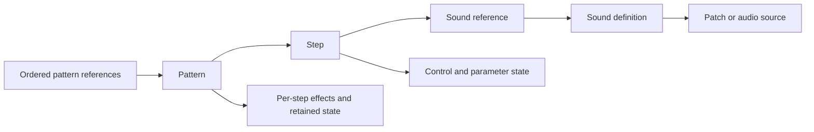

# Shared sequencer field map

[Family comparison](FAMILY_RELATIONSHIPS.md) · [PO-32](PO32.md) ·
[PO-33/133](PO33.md) · [PO-35/137](PO35.md)

Treat these formats as variants of a common sequencer and sound-reference
model. Packing differences do not by themselves make fields unrelated.
The useful comparison is the role and coordinate of a field: which pattern,
step, sound, control channel or retained-state object it belongs to.



The PO-33 grid contains sequencer cells, not embedded sound objects. A column
implicitly identifies a sound slot, whose header can reference shared audio.
PO-32/35 lanes encode more of the sound selection inside their event bytes.
Both approaches can be projected into a step/sound view. A compact lane's
unselected cells are **not stored**, rather than stored zero values.

Across the sampler frames, native topology checks counted 563 sound headers:
167 carried pool data and 396 only referenced pools. Every source selector
resolved within its frame. The common grid therefore refers to sound
identities; ownership of the underlying audio is a separate relationship.

## Scope and validation

The alignment revalidates 341 distinct archived frames: 65 PO-32, 187 sampler
and 89 speech-family frames. Overlapping catalogs supplied 431 provenance
entries; those are not 431 independent captures. Original waveform files were
not newly demodulated in this pass.

The common view rebuilds all 3,133 full-pattern occurrences and 293 settings
records exactly. Pattern bodies are deduplicated without their slot index,
leaving 59, 178 and 62 distinct bodies respectively. Native parser checks also
pass under ASan/UBSan; deliberate checksum corruption is rejected for every
family. Coordinate fixtures cover absent cells, retained inactive selectors,
unknown bits, reserved speech selectors and a chain longer than the legacy
PO-32 typed capacity.

These are representation checks. They do not establish identical firmware,
DSP, timing or receiver behavior across devices.

## Align by role

All indices and payload offsets below are zero-based.

| Common role | PO-32 | PO-33/133 | PO-35/137 |
| --- | --- | --- | --- |
| Pattern identity | First pattern byte | Separate pattern selector | First pattern byte |
| Sound reference at a step | Lane plus selector-group bits | Sound column | Speech event high nibble; separate drum-key selector |
| Step parameters | Two bytes per selected drum-lane cell | One packed 24-bit word per step/sound cell | Four speech bytes and two drum bytes per step |
| Key and timing information | Drum selection plus low fill code; accent remains separate | Low key-related nibble, high timing-related nibble | Speech: high note, low gate in secondary byte; drum: high key, low event/multiplier code |
| Current/default controls | Sixteen two-byte drum pairs | Standalone table not located | Fifteen speech control/state entries, then sixteen drum pairs |
| Chain | Count at 34, IDs from 35 | Count at 383, fixed 128-entry storage from 255 | Count at 155, IDs from 156 |
| Tempo / swing coordinate | 32 / 33 | 384 / 385 | 152 / 153 |
| FX code track | Candidate low nibble in sixteen trailing bytes | Sixteen codes packed into eight bytes, high first | Candidate high nibble in sixteen index-pair bytes |
| FX/reference state | Candidate high nibble of those trailing bytes | Separate sixteen-byte settings state; pattern-axis associations | Sixteen per-step state bytes inside each pattern |

For PO-32, the zero-based sound slot is
`lane + 4 * ((event >> 4) & 3)`. The legacy C API's one-based instrument
numbers are a presentation conversion, not a different wire-ID convention.
PO-35's Sound 16 drum section additionally needs a drum-key coordinate; it
must not be confused with an unassigned speech selector of 15.

Keep the owner/axis of retained state explicit. A sixteen-entry per-pattern
settings array and a sixteen-entry per-step pattern array can have related
purposes without being the same object. Likewise, PO-32's accent mask and
PO-35's reference-related mask cannot both be renamed an active-step bitmap.

## Exact global-state correspondence

Removing the PO-35 speech-default prefix and its extra retained byte gives a
PO-32-shaped global record:

```text
PO-32-shaped bytes = PO-35 settings[120:154] + settings[155:]
                    (half-open slices)
```

One captured pair matches byte-for-byte under this transformation: all sixteen
drum-control pairs, tempo 140, swing-coordinate zero, chain length one and
pattern ID 3. The complete matching record is 36 bytes. This is a concrete
layout/content correspondence, not merely two records with similar lengths.

The drum-default bank consisting of sixteen `80 01` pairs occurs in four
distinct PO-32 frames and 41 speech-family frames. Additional shared individual
pairs are `01 FF`, `01 01`, `FF FF` and `80 FF`. There are also 49 PO-32
transfers with both knob messages: kind 0 carries 128 and kind 1 carries 1.

The original Microtonic exporter independently writes `80` followed by its
encoded morph value in both state and populated pattern pairs, and writes the
corresponding neutral knob messages for sound transfer. Together with the
PO-35 pitch/morph pair, this makes PO-32's historically named `flag` byte a
strong pitch-control candidate. The observations do not calibrate its audible
curve or justify changing the existing API's meaning by assumption.

In the 65 validated PO-32 frames, 17 carry state records. Their first drum-pair
bytes have 28 distinct values, with `128` at 234/272 positions. Of the 14
state-bearing frames with active drum steps, ten match the same-slot state byte
at every active step and four contain per-step differences. That fits defaults
plus locks, but no labelled nonneutral knob-A/state pair isolates a pitch law:
all 49 frames with knob messages carry knob-A value `128`.

An older five-point PO-32-format knob transfer series used values
`1/64/128/192/255` with the same patch data and paired to those same saved
PO-35 drum-pitch bytes. Those are historical PO-35 readbacks, not PO-32 state
readbacks; the input/capture pairing was not freshly replayed. The result
supports the PO-35 pitch-byte role without proving that PO-32's `flag` has the
same numeric law.

The inspected drum sets contain 211 distinct PO-32 patch bodies and 75
speech-family patch bodies, with no exact body shared between them. Matching
control values therefore do not supply a matched same-patch playback test.

## A nibble swap aligns key/timing fields

The same transformation aligns two useful contexts:

| PO-33 context | Swap high and low nibbles | Corresponding PO-35 role |
| --- | --- | --- |
| Melodic control: low note-related code, high duration-related code | `FC` becomes `CF` | Speech secondary byte: note code 12, gate code 15 |
| Drum control: low slice/key-related code, high retrigger-related code | `2A` becomes `A2` | Drum event: key code 10, multiplier/event code 2 |

These tuples occur in the retained data. After expanding PO-32's lane/group
selector, the non-default raw tuple `(key 10, timing 2)` also occurs in its
drum data. Its separate accent and unassigned bits must still be preserved.

The context distributions agree with the proposed role alignment: timing `F`
occurs in 978 of 1,089 nonzero melodic sampler controls and 490 of 682 speech
rows with a nonzero event code. Timing/event `1` dominates all three drum contexts. There are
33 shared melodic note/timing tuples and 16 shared sampler/speech-family drum
key/timing tuples in these populations.

This supports comparing key/timing codes after a packing transformation.
It does **not** establish identical note scales, physical slice-key numbering,
repeat counts or gate units. PO-35's independent onset/continuation field also
has no separately identified counterpart in the PO-33 control byte. Preserve
that distinction instead of inventing an onset field for every sampler cell.

## Parameter state survives without an event

Among distinct pattern bodies, these stored cells have zero control/event
codes but nonzero parameters:

| Family | Cells |
| --- | ---: |
| PO-32 | 316 |
| PO-33/133 | 852 |
| PO-35/137, speech and drums combined | 84 |

This is a common storage property. It does not prove that every such value is
applied during playback: retained editor history and interpolation state remain
possible. A shared inspector must keep event presence and parameter presence
separate. Collapsing both into a single on/off dot loses information.

All active chain IDs fall in 0..15 and resolve to a transmitted full record or
marker in this corpus; each family has examples with repeated IDs. The sampler
also retains unused chain storage, with nonzero unused entries in seven states.
Preserve those entries. Omitted records, empty markers and zero-filled full
patterns remain distinct even when they would draw the same empty grid.

The sampler's settings prefix and suffix each have only one byte profile
across all 187 states. They do not provide a varying knob-default table here.
The location or serialization of standalone sampler defaults remains open.
Its parameter word also keeps bit 5 clear in all 2,776 nonzero words examined;
that still does not distinguish the lower pitch/level widths. Separate later
[PO-33 and PO-133 hardware comparisons](PO33.md#resonance-storage-validation)
identify FILTER B with bits 18..23 and endpoints 0/63, while preserving every
other field in each bank. This rules out the simple independent packing that
assigns bit 18 to FILTER A and
only bits 19..23 to B. The lower-field alternatives and acoustic scales remain
unresolved; these hardware comparisons do not alter the offline corpus counts
above.

A subsequent [PO-33 control test](PO33_CONTROLS.md) preserved synthetic bit 5
through device readbacks without a resolved playback effect in the tested
pairs. Selected volume/filter zeros reproduced the preceding settings, but
the unchanged other controls leave per-control retention versus whole-row
skipping unresolved. Shared architecture does not make these zeros equivalent
to PO-35 continuation controls. These later tests do not extend the archived
corpus counts or establish independent PO-133 playback behavior.

## FX correspondence and useful predictions

PO-32's candidate FX code/reference pair is packed into one byte; PO-35's
candidate code and reference occupy separate step arrays. PO-35's reference
bytes all fit 0..15; the PO-32 candidate is already a nibble by construction.
Excluding the observed baseline codes (0 and 7 respectively), the referenced
step has the same candidate effect code at 200/226 PO-32 positions and
150/150 PO-35 positions. The PO-32 exceptions and two PO-35 baseline exceptions
remain counterexamples to a universal current-code lookup. These counts are
corpus associations, not probabilities of semantic correctness.

In the expanded distinct-pattern corpus, candidate references point to the
current step at 67/76 PO-32 and 26/26 PO-35 nonzero-step effect-run onsets.
Baseline storage differs: all 718 PO-32 code-0 positions are raw `00`, while
118/842 PO-35 code-7 positions retain a nonzero step reference. Both families
also have constant-code bars referring to step 15 rather than the current run
start. These are correlated pattern observations, not authenticated edit
gestures. A writer that derives baseline or reference bytes from FX codes
would discard valid retained state.

The official [PO-33 guide](https://teenage.engineering/guides/po-33/en) and
[PO-35 guide](https://teenage.engineering/guides/po-35/en) place the same four
actions on buttons 13..16. Under direct ordinal indexing, they predict:

| Action | Candidate PO-33 code | Candidate PO-35 code |
| --- | ---: | ---: |
| 6/8 quantize | C | 4 |
| Retrigger pattern | D | 5 |
| Reverse | E | 6 |
| No effect | F | 7 |

These are **predictions**, not a new verified enum. PO-33 octave-up code 6 and
the observed baseline codes anchor the idea, but do not prove all other entries.
An isolated known-action comparison can test the mapping. PO-32's documented
button order differs, so the same numeric offset must not be applied there.
See the [PO-32 guide](https://teenage.engineering/guides/po-32/en).

## What this supports sharing

The evidence supports a common read-only vocabulary for pattern references,
ordered chains, step/sound coordinates, raw parameter slots, key/timing fields
and scoped retained state. Preserve family-specific packing and unknown values
when moving between that view and bytes.

The best remaining comparisons are the first PO-32 control byte versus PO-35
pitch, key/timing conversions after the nibble swap, and the predicted shared
FX actions. Numeric control laws, FX playback and firmware code reuse remain
separate questions. The common view is an investigation tool, not an added
public editor API or a claim that all families can play each other's patterns.
